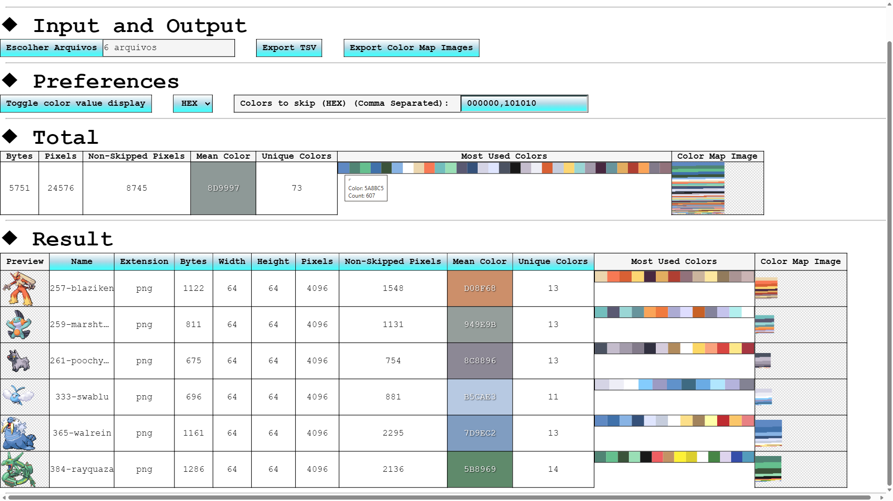

# Mean Color Calculator

## What

A browser tool that analyzes images to calculate mean colors, count unique colors, identify the most used colors, generate color maps, and view overall image statistics.

## Characteristics

- **Mean Color Calculation**: Calculate the mean color of an image.
- **Skippable Colors**: Exclude specific colors from the analysis.
- **Most Used Colors**: Find the most frequently occurring colors and their pixel counts.
- **Color Map Images**: Generate images representing colors sorted from most to least used.
- **Multiple Color Formats**: View color values as RGB, HEX, or HWB.
- **Batch**: Analyze multiple images at once and calculate statistics for the entire batch.
- **Sorting**: Sort images by name, extension, or color.
- **Export**: Export results as TSV, JSON and color map images.
- **Image Details**: View file size, dimensions, pixel count, and number of unique colors.
- **Supported Formats**: PNG, JPG, JPEG, GIF, BMP, WEBP, AVIF, SVG, and ICO.
- **Pure Web**: Built entirely with HTML, CSS, and JavaScript. Runs directly in any modern web browser without installation.

## Why

This tool aims to help analyze and compare the colors of textures and sprites.
The initial goal behind its creation was to create flat texture mods and compare the color variety of sprites from different games.

## Usage instructions

Go to https://felipert98.github.io/MeanColorCalculator/

OR

1. Clone or download this repository.
2. Open index.html in your web browser.

No installation or additional software is required.
